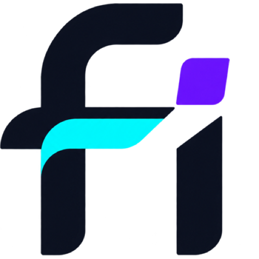

# fi

[English](README.md) | 中文



**你的模型，你的工作区。**

面向 Windows、macOS 和 Linux 的一体化编程智能体。登录支持的 AI 订阅账号或连接 API 提供商，即可在一个工作区内编辑代码、搜索网页并生成图像。也提供用于本地开发的浏览器应用。

[下载 v1](https://github.com/OJamals/fi/releases/tag/v1.0.0) · [开始使用](#get-started) · [用户指南](docs/user/index.zh.md) · [从源码运行](#run)


23 秒界面演示，录制于 2026 年 10 月 14 日的本地构建。展示控件和设置，不包含真实模型回复。[观看或下载视频](https://github.com/OJamals/fi/raw/refs/heads/fi-readme-assets/2026-10-14/fi-walkthrough.mp4)。

## 下载

| 平台 | v1.0.0 下载 | 签名 |
|---|---|---|
| macOS · Apple Silicon | [DMG](https://github.com/OJamals/fi/releases/download/v1.0.0/fi-1.0.0-mac-arm64.dmg) | 已签名并公证 |
| Windows · x64 | [安装程序](https://github.com/OJamals/fi/releases/download/v1.0.0/fi-1.0.0-win-x64-unsigned.exe) | 未签名 |
| Linux · x64 | [AppImage](https://github.com/OJamals/fi/releases/download/v1.0.0/fi-1.0.0-linux-x64.AppImage) | 未签名 |

查看[发行说明和全部下载](https://github.com/OJamals/fi/releases)。macOS：打开 DMG，将 fi 拖入 Applications。Windows：运行安装程序。Linux：为 AppImage 添加可执行权限后打开。

<a id="get-started"></a>

## 开始使用

1. 打开 fi，选择项目文件夹。
2. 打开 **设置 → 模型**。登录支持的订阅账号或添加 API 提供商。
3. 为对话选择模型。仅添加提供商不会自动选择模型。
4. 描述任务，审核权限请求，然后检查文件修改。

账号权限、模型和配额取决于提供商。在授予工具本地文件或命令访问权限前，请阅读[安全指南](SAFETY.zh.md)。

## 功能

- **在工作区内编程。** 使用文件工具、终端、持久化对话、规划和子智能体。
- **选择模型。** 连接支持的订阅账号、API 密钥或自定义提供商。参见[账号设置](packages/fi/client-ui-model-signin/README.zh.md)。
- **搜索网页。** 在 **插件 → 首选网页搜索** 中选择自动路由或搜索提供商。自动路由优先使用支持的订阅搜索，否则使用免费的 Bing 搜索。[搜索设置](packages/fi/web-search-preferences/README.zh.md)。
- **生成和编辑图像。** 使用已配置的 Codex、Grok 或 Antigravity 订阅目标。图像工具需要具有相应权限的账号，不会静默切换提供商或 API 计费。[图像设置](packages/fi/tool-image-generation/README.zh.md)。
- **使用独立检出目录。** 托管 Git worktree 从已提交的 HEAD 创建，不复制未提交的修改。[Worktree](packages/api/workspace-controller/README.zh.md#managed-worktrees)。
- **审核修改。** 查看每轮文件修改并恢复支持的编辑。恢复数据仅在 Host 运行期间保留，请自行备份。[文件审核](packages/deliverables/workspace-changes/README.zh.md)。
- **自定义体验。** 调整正文、代码和终端字体；管理插件；导入支持的 Claude Code 和 Codex 扩展内容。导入的 MCP 服务器和 hooks 默认禁用。[插件兼容](packages/extensions/plugin-compat/README.zh.md)。

## 更新

稳定版桌面应用从已发布的 [GitHub Releases](https://github.com/OJamals/fi/releases) 检查更新。在应用菜单中选择 **检查更新**。预览版跟随预发行版本，草稿不会被使用。

<a id="run"></a><a id="run-from-source"></a>

## 从源码运行

需要 Node.js `^22.19.0 || >=24.0.0` 和 pnpm `11.7.0`。

```sh
git clone https://github.com/OJamals/fi.git
cd fi
pnpm install
pnpm run dev:desktop
```

浏览器应用使用 `pnpm run dev:web`。发送消息前请配置模型。源码 CLI 和 Web 的状态默认位于 `~/.fi`；`dsh` 和 `DSH_*` 仍是运行时配置接口。

## 开发

fi 基于由 DeepSeek AI 原始开发的 [DeepSeek Harness (DSH)](https://github.com/deepseek-ai/deepseek-harness) 和 [Cordis](https://github.com/cordiverse/cordis)。它保留插件运行时，并添加模型账号连接、搜索和图像工具、工作区控件，以及独立的桌面品牌和更新渠道。可选功能取决于当前 profile 和插件。

参见[开发指南](docs/development.zh.md)、[架构](docs/architecture.zh.md)、[桌面打包](apps/desktop/README.zh.md)和[贡献指南](CONTRIBUTING.zh.md)。智能体遵循 [AGENTS.md](AGENTS.md)。

## 许可证

[MIT](LICENSE)。[第三方声明](THIRD_PARTY_NOTICES.md)。
