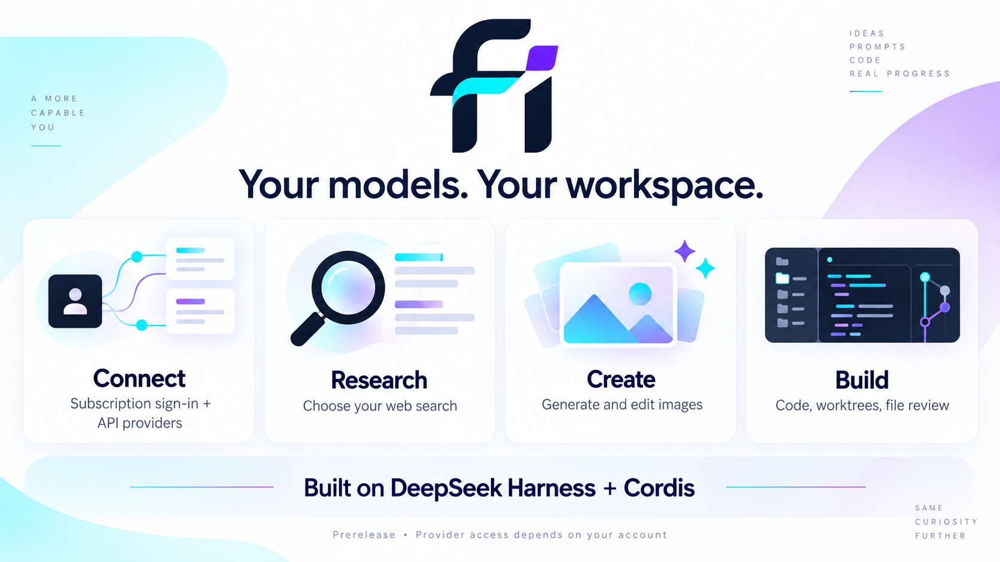
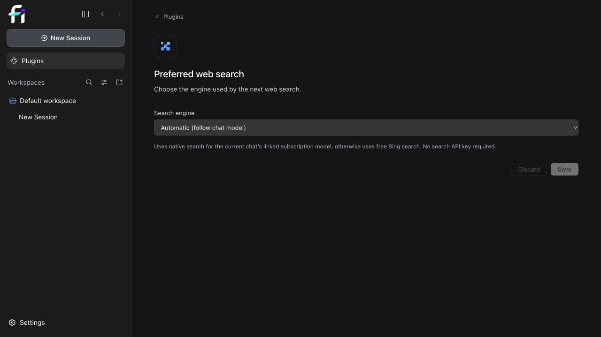

# fi

[English](README.md) | 中文


**你的模型，你的工作区。**

fi 是基于 [DeepSeek Harness（DSH）](https://github.com/deepseek-ai/deepseek-harness) 和 [Cordis](https://github.com/cordiverse/cordis) 构建的预发布 coding agent 应用。你可以用它处理本地项目、连接模型订阅或 API 提供方、使用所选搜索引擎开展研究，并在编写代码的同时生成图像。它可在原生桌面壳中运行，也可通过浏览器连接本地运行时。



概念功能图，非应用截图。提供方和模型的访问权限取决于你的账号。

## DSH 基础与 fi 扩展

fi 保留了 DSH 的插件化 agent 运行时：持久化会话、文件与 shell 工具、终端、技能、MCP、子 agent、规划、后台作业及权限控制。可选 bundle 包括浏览器/计算机操作、语音输入、agent 团队和定时任务；可用性取决于所选 profile 与已启用插件。这些能力来自 DSH 基础，并非 fi 独有功能。参见[用户指南](docs/user/index.zh.md)与[架构](docs/architecture.zh.md)。

fi 层增加了账号连接、感知提供方的默认设置、搜索与图像工具，以及具有独立品牌和更新通道的桌面体验。它也整合了部分上游改进；下表描述本分支的能力，并不表示当前上游 DSH 缺少这些能力。

| 能力 | fi 增加或适配的内容 | 收益 |
|---|---|---|
| 模型连接 | 统一订阅登录区、提供方设置、受支持提供方的实时模型发现，以及 API 密钥/自定义提供方配置 | 无需经过强制 DeepSeek 账号欢迎步骤即可选择提供方 |
| 原生适配器 | 在 Claude、Codex 和 Grok 订阅集成之外提供 Antigravity、OpenCode Console 与 Ollama Cloud | 通过应用使用已有的合资格账号 |
| 搜索选择 | 自动路由、免费 Bing 搜索、订阅搜索和可配置的 API 搜索提供方 | 独立于编码工具选择 agent 的研究方式 |
| 图像创建 | 基于订阅的文生图和工作区图像编辑 | 在同一项目工作流中创建视觉资源 |
| 隔离开发 | 从已提交 HEAD 创建、由应用管理的本地 Git 工作树 | 为任务提供独立分支和检出目录 |
| 文件审阅 | 每轮文件变更对比，以及受保护的修改前/修改后恢复 | 撤销或重做文件修改，同时拒绝覆盖后续编辑 |
| 插件复用 | 显式导入受支持的本地 Claude Code 与 Codex 插件内容 | 复用技能、MCP 服务器和 hooks，并分别控制启用 |
| 日常导航 | 后退/前进控件、工作区/会话菜单、英语优先的首次引导及 macOS 标题栏整合 | 更顺畅地切换项目和应用面板 |
| 阅读与配置 | 独立的正文/代码/终端字体和字号、工作详情控制、有序的模型选择及插件管理 | 调整界面并查看 profile 中启用的工具 |

工作树不会复制源目录中未提交的修改。文件对比与恢复数据仅在 Host 生命周期内保留，并非永久备份。插件兼容需要在 profile 中启用，仅支持 Claude Code 和 Codex 的部分功能；导入的 MCP 服务器和 hooks 默认禁用。详见[工作树](packages/api/workspace-controller/README.zh.md#managed-worktrees)、[文件审阅](packages/deliverables/workspace-changes/README.zh.md)及[插件兼容](packages/extensions/plugin-compat/README.zh.md)。

## 连接模型

打开 **设置 → 模型**，添加 API 提供方或使用 **使用您的订阅登录**。fi 已提交的集成包括 Anthropic、OpenAI Codex、xAI、Antigravity、OpenCode Console 与 Ollama Cloud。登录并添加提供方后再选择模型；仅切换提供方选择器不会改变会话模型。

Ollama Cloud 使用原生设备批准流程，不需要本地 Ollama daemon。Antigravity 需要合资格账号，以及来自本地安装或显式配置的 OAuth client。模型列表、账号权益、配额和提供方可用性各不相同。订阅登录不保证能使用所有模型或功能。参见[登录控件](packages/fi/client-ui-model-signin/README.zh.md)、[Antigravity](packages/fi/llm-antigravity/README.zh.md)、[OpenCode Console](packages/fi/llm-opencode/README.zh.md)及 [Ollama Cloud](packages/fi/llm-ollama/README.zh.md)。

源码还包含 GitHub Copilot、Cursor、Kiro、Cline Free / Pass 和 Gemini Code Assist 的原生集成。它们提供文本和函数工具能力，并受各提供方的限制；Cline 需要账号 API 密钥，Google Code Assist 需要相应权益。界面中出现这些集成，并不证明账号访问成功或已包含在公开 release 中。

## 研究与创作

在 **插件 → 首选网页搜索** 中，自动路由会为受支持且已关联订阅的会话使用原生搜索，其余情况使用免费 Bing 搜索。需要时可显式选择 Bing、订阅搜索、DeepSeek 官方、Exa、Perplexity、Parallel、Tavily、Serper 或 Brave Search。API 搜索提供方需要各自配置的凭据。参见[搜索路由](packages/fi/web-search-preferences/README.zh.md)。

`image_gen` 工具通过配置的 Codex、Grok 或 Antigravity 目标，根据提示生成图像或编辑可读取的工作区图像。它需要所选提供方的订阅凭据，不会静默切换为 API 密钥计费或其他提供方。Claude 会话需要配置上述图像目标之一。参见[图像生成](packages/fi/tool-image-generation/README.zh.md)。



采用全新状态的本地源码构建截图；未展示提供方账号或推理请求。

<a id="run"></a><a id="run-from-source"></a>

## 从源码运行

需要 Node.js `^22.19.0 || >=24.0.0` 与 pnpm `11.7.0`。

```sh
git clone https://github.com/OJamals/fi.git
cd fi
pnpm install
pnpm run dev:desktop
```

浏览器应用使用 `pnpm run dev:web` 启动。发送第一条消息前请配置模型。fi CLI 和 Web 默认使用 `~/.fi`；`dsh` 命令与 `DSH_*` 设置仍是运行时的配置接口。

使用 `pnpm run build:official` 生成官方 Web 构建。桌面打包目标包括 macOS 与 Windows；打包、签名与发布命令见 [`apps/desktop`](apps/desktop/README.zh.md)。

## 更新

生产桌面构建从已发布的 [fi GitHub Releases](https://github.com/OJamals/fi/releases) 读取已签名更新元数据。Preview 构建跟随 preview prerelease，稳定构建跟随稳定 release；草稿 release 会被忽略。

## 项目状态

本 README 描述源码能力。源码 package 版本为 `0.2.0-rc.2`；桌面 release 使用独立版本，包含的功能可能较少。请在 [fi Releases](https://github.com/OJamals/fi/releases) 中选择可用构建并阅读其说明。本地未签名构建不属于已签名或公证的发布制品。

fi 处于预发布阶段，可能发生破坏性变更。使用前请阅读 [SAFETY.zh.md](SAFETY.zh.md)。DeepSeek Harness 最初由 DeepSeek AI 开发；fi 保留该归属说明以及底层 DSH package 与 CLI 名称。

## 开发

参见[开发](docs/development.zh.md)、[架构](docs/architecture.zh.md)与[贡献](CONTRIBUTING.zh.md)文档。

`pnpm run dev:web` 会在一个终端里完成构建、启动，并在源码修改时重建 client bundle；`make help` 列出 Web 与 Desktop 对应的 Make target。完整表格见开发指南的「应用命令」一节。

面向 agent：请遵循 [AGENTS.md](AGENTS.md)。

品牌资源：[默认 fi 标志](apps/desktop/build/fi-logo-source.png)及[用于深色背景的透明白色版本](apps/desktop/build/fi-logo-dark-background.png)。

## 许可证

[MIT](LICENSE)。第三方许可证见 [THIRD_PARTY_NOTICES.md](THIRD_PARTY_NOTICES.md)。
